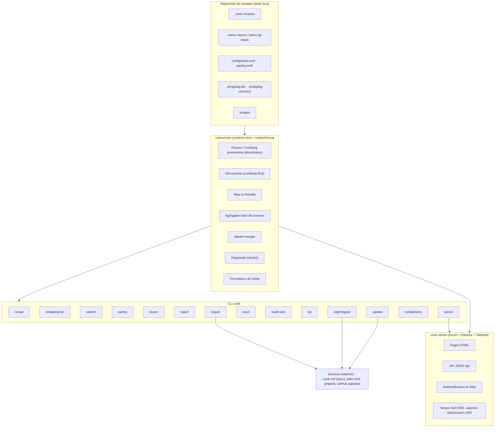

# Cartographie des fonctionnalités de CookCLI

CookCLI (`cook`) gère une bibliothèque de recettes [Cooklang](https://cooklang.org)
stockées en texte brut (`.cook`, `.menu`). Le projet a deux faces : **une CLI**
(une commande = une tâche, philosophie UNIX) et **un serveur web** (`cook server`)
qui expose la même logique avec une interface rendue côté serveur.

## Vue d'ensemble

## 1. Commandes CLI

| Domaine | Commande | Fonctionnalités | Code |
|---|---|---|---|
| **Recette** | `cook recipe [read]` | Lire / valider / afficher une recette (fichier, nom, ou stdin). Mise à l'échelle `recette.cook:2` ou `--scale`. Formats : `human`, `json`, `yaml`, `cooklang`, `markdown`, `latex`, `typst`, `schema` (schema.org JSON-LD) | `src/recipe/`, `crates/format/` |
| **Courses** | `cook shopping-list` (`sl`) | Liste agrégée de plusieurs recettes/menus, fusion des ingrédients identiques, conversion d'unités, tri par rayon (`aisle.conf`), filtrage par garde-manger, `--plain`, sortie fichier, formats multiples | `src/shopping_list.rs`, `crates/core/src/shopping_list/` |
| **Recherche** | `cook search` | Recherche plein texte (titres, ingrédients, étapes, métadonnées), classement par pertinence | `src/search.rs`, `crates/core/src/search.rs` |
| **Garde-manger** | `cook pantry list/add/update/remove` | CRUD des articles de `pantry.conf` (TOML édité avec `toml_edit`, commentaires préservés) | `src/pantry.rs`, `crates/core/src/pantry/` |
| | `cook pantry depleted / expiring` | Articles épuisés, articles proches de la péremption | |
| | `cook pantry recipes / plan` | Recettes réalisables avec le stock, planification | |
| **Diagnostic** | `cook doctor [validate]` | Syntaxe, fonctionnalités dépréciées, références de recettes ; mode strict (code 1) pour CI | `src/doctor.rs`, `crates/core/src/doctor.rs` |
| | `cook doctor aisle` | Ingrédients absents de `aisle.conf` (`--show-recipes`), détection des faux commentaires `#`/`--` | `crates/core/src/aisle.rs` |
| | `cook doctor pantry` | Ingrédients déjà présents dans le garde-manger | |
| **Rapports** | `cook report -t tpl.j2` | Sorties personnalisées via templates Jinja2 (cooklang-reports) : fiches, nutrition, plans… avec échelle, datastore, rayons, garde-manger | `src/report.rs`, `crates/core/src/report.rs` |
| **Import** | `cook import <URL>` | Import depuis un site web et conversion en Cooklang (`--skip-conversion` possible) | `src/import.rs` (feature `import`) |
| **Site statique** | `cook build web` | Génère un site HTML autonome : index, pages recettes, flux Atom/RSS/JSON, sitemap, langue fixée par `--lang`, `--base-url`, `--compress` (.gz) | `src/build/` |
| **Démarrage** | `cook seed` | Crée des recettes d'exemple | `src/seed.rs` |
| **Éditeur** | `cook lsp` | Serveur de langage Cooklang : diagnostics temps réel, complétion, coloration sémantique, survol, symboles | `src/lsp.rs` (feature `lsp`) |
| **Compte cook.md** | `cook login` / `cook logout` | Connexion par device-code, `session.json` dans le dossier de config global | `src/login.rs`, `src/logout.rs`, `src/sync/` |
| **Serveur** | `cook server` | Interface web (voir §2) | `src/server/` (feature `server`) |
| | `cook server user add/passwd/role/remove/list` | Gestion du fichier `users.toml` | `src/server/auth/cli.rs` |
| **Outillage** | `cook update` | Auto-mise à jour (`--check-only`, `--force`), désactivable à la compilation | `src/update.rs` (feature `self-update`) |
| | `cook completions <shell>` | Complétion bash, zsh, fish, powershell, elvish | `src/completions.rs` |

Option globale : `-v/-vv/-vvv` (verbosité).

## 2. Serveur web (`cook server`)

### 2.1 Pages

| Page | Route | Fonctionnalités | Template |
|---|---|---|---|
| Bibliothèque | `/`, `/directory/…` | Navigation par dossiers, fil d'Ariane, cartes recettes, tri, bannière « menu du jour » | `recipes.html`, `recipe_card.html` |
| Recette au hasard | `/random`, `/random/…` | Ouvre une recette aléatoire (globale ou d'un dossier) | — |
| Recette | `/recipe/…` | Ingrédients, étapes en boîtes, badges ingrédient/ustensile/minuteur, métadonnées, image, mise à l'échelle (URL), ajout à la liste de courses, impression, **mode cuisine**, minuteurs | `recipe.html` |
| Menu / plan de repas | `/recipe/….menu` | Affichage par jours/repas, mise à l'échelle, **édition du calendrier** (ajout via sélecteur, déplacement, copie, glisser-déposer), ajout aux courses | `menu.html`, `static/js/src/planner.js` |
| Recherche | `/search` | Résultats plein texte + recherche instantanée dans l'en-tête | `search.html`, `static/js/search.js` |
| Édition | `/edit/…` | Éditeur CodeMirror : coloration Cooklang, autocomplétion via LSP (WebSocket), barre d'outils d'insertion, sélecteur de recette, renommage, suppression | `edit.html`, `static/js/src/editor.js`, `toolbar.js`, `cooklang-mode.js` |
| Nouveau fichier | `/new` | Création de recette ou de menu | `new.html` |
| Liste de courses | `/shopping-list` | Liste persistante, cochage, articles libres, regroupement par rayon, filtrage garde-manger, copie, compactage, **mise à jour en direct** (SSE + watcher fichier) | `shopping_list.html` |
| Garde-manger | `/pantry` | Sections, ajout/édition/suppression, quantités, dates, alertes péremption/épuisé, édition brute du fichier | `pantry.html` |
| Rayons | `/aisles` | Gestion de `aisle.conf`, ingrédients non classés, édition brute | `aisles.html` |
| Préférences | `/preferences` | Configuration, langue, thème, synchronisation cook.md | `preferences.html` |
| Documentation API | `/api-docs` | Doc générée de l'API (aussi `docs/api.md`) | `api_docs.html` |
| Flux | `/atom.xml`, `/rss.xml`, `/feed.json` | Flux des recettes | — |
| Connexion | `/login`, `/logout` | Sign-in si `users.toml` existe | `login.html` |

### 2.2 API JSON (`/api`)

| Groupe | Endpoints |
|---|---|
| Recettes | `GET /recipes`, `GET/PUT/DELETE /recipes/{path}`, `GET /recipes/raw/{path}`, `POST /recipe_rename/{path}`, `/recipe_image/{path}` |
| Menus & plans | `GET /menus`, `GET /menus/{path}`, `POST /plans/{path}` (édition avec contrôle de version) |
| Liste de courses | `POST /shopping_list`, `GET /shopping_list/items`, `add`, `add_menu`, `remove`, `clear`, `extra_items`, `remove_extra_item`, `check`, `uncheck`, `checked`, `compact`, `events` (SSE) |
| Garde-manger | `GET /pantry`, `add`, `rename`, `raw`, `PUT/DELETE /pantry/{section}/{name}`, `expiring`, `depleted` |
| Rayons | `GET /aisles`, `aisles/raw`, `POST aisles/changes`, `aisles/uncategorized` |
| Divers | `GET /search`, `GET /stats`, `GET/POST /reload`, `GET /ws/lsp` (WebSocket LSP) |
| Sync cook.md | `sync/status`, `sync/login`, `sync/cancel_login`, `sync/logout` (feature `sync`) |
| Statique | `/static/…` (assets embarqués), `/api/static` (images du dossier uniquement, jamais de fichier caché) |

### 2.3 Expérience front-end transverse

- **Mode cuisine** plein écran, étape par étape (`cooking-mode.js`) et **minuteurs** (`timers.js`)
- **Raccourcis clavier** : `/` recherche, `g h/s/p/x` navigation, `t` thème, `?` aide ; sur une recette `c` cuisine, `e` édition, `a` courses, `p` impression, `+/-` et `[ ]` échelle
- **Garde-fou « modifications non enregistrées »** (`unsaved.js`)
- **Avis de connexion** quand une écriture est refusée (`sign-in-notice.js`)
- **Thème clair/sombre**, design responsive mobile
- **i18n** : 10 langues (de, el, en, es, eu, fr, it, ja, nl, sv) via Fluent (`locales/`), choix selon `Accept-Language`

### 2.4 Sécurité, déploiement et exploitation

| Thème | Fonctionnalités | Code |
|---|---|---|
| Authentification | `users.toml` (argon2) active la connexion ; rôles `reader` < `shopper` < `editor` < `admin` ; révocation de sessions ; rechargement à chaud du fichier | `src/server/auth/` |
| Mode lecture seule | `--recipes-only` / `COOK_RECIPES_ONLY` : les invités ne voient que les recettes (liste blanche) | `auth/middleware.rs` |
| Réseau | Écoute locale par défaut, `--host`, `--port`, `--open` | `src/server/mod.rs` |
| CORS / anti-rebinding | `--cors-origin` (ou `COOK_CORS_ORIGIN`), `--cors-credentials`, vérification Host/Origin, `--no-csrf-check` | `src/server/cors.rs` |
| Reverse proxy | `--url-prefix`, `--proxy-strips-prefix` (Traefik, nginx, Home Assistant ingress) | |
| LSP distant | Pont WebSocket vers des sous-processus `cook lsp`, nombre de sessions limité | `src/server/lsp_bridge.rs` |
| Journal d'activité | Une ligne stdout par modification (qui a fait quoi) | `src/server/activity.rs` |
| Confidentialité | Chemins absolus masqués dans les erreurs | `src/server/private_paths.rs` |
| Écritures sûres | Écriture atomique des fichiers | `fs_atomic.rs` |
| Synchronisation | Sync du dossier avec cook.md (`sync.db`) au démarrage si connecté | `src/sync/` |
| Conteneur | Dockerfile, docker-compose, entrypoint | racine |

## 3. Configuration et fichiers

| Fichier | Rôle | Recherche |
|---|---|---|
| `aisle.conf` | Rayons du magasin → ingrédients (commentaires `//` seulement) | `./config/` puis dossier global |
| `pantry.conf` | Stock (TOML : quantités, dates, seuils) | idem |
| `users.toml` | Comptes du serveur | dossier global, `--users-file`, `COOK_USERS_FILE` |
| `session.json`, `sync.db` | Session et état de sync cook.md | dossier global |
| `.shopping-list`, `.shopping-checked` | Liste de courses du serveur | racine du dossier de recettes |

Dossier global : `$COOK_CONFIG_DIR`, sinon `~/.config/cook/` (Linux),
`~/Library/Application Support/cook/` (macOS), `%APPDATA%\cook\config\` (Windows).

## 4. Architecture et features Cargo

| Élément | Contenu |
|---|---|
| `cookcli` | Binaire : CLI, serveur, build statique, sync |
| `crates/core` (`cookcli-core`) | Logique métier : parseur, recherche, recette, liste de courses (+ store, jours), garde-manger, rayons, doctor, rapports |
| `crates/format` (`cooklang-format`) | Formateurs publiés : human, markdown, latex, typst, schema.org, source Cooklang |
| Dépendances Cooklang | `cooklang` (parseur), `cooklang-find`, `cooklang-reports`, `cooklang-import`, `cooklang-language-server`, `cooklang-sync-client` |
| Features | `default = self-update, sync, server, import, lsp` ; l'image Docker n'embarque que `server,lsp` |

## 5. Couverture de tests

- **Rust** (`tests/*.rs`, snapshots `insta`) : CLI, formats, doctor, config, API docs, locales.
- **Playwright** (`tests/e2e/`, 34 specs) : navigation, affichage et échelle des recettes, recherche,
  liste de courses (live, copie, retrait, garde-manger), garde-manger, rayons, éditeur (autocomplétion,
  coloration, barre d'outils, renommage), menus et plans (édition, échelle, courses), mode cuisine,
  préférences, avis de connexion, modifications non enregistrées, accessibilité, performance.

## 6. Matrice fonctionnalité × surface

| Fonctionnalité | CLI | Web dynamique | Site statique |
|---|:-:|:-:|:-:|
| Afficher une recette / la mettre à l'échelle | ✅ | ✅ | ✅ |
| Formats d'export (JSON, YAML, LaTeX, Typst…) | ✅ | partiel (raw, JSON) | — |
| Recherche | ✅ | ✅ | — |
| Liste de courses | ✅ (ponctuelle) | ✅ (persistante, live) | — |
| Garde-manger | ✅ | ✅ | — |
| Rayons | doctor | ✅ (édition) | — |
| Menus / plans de repas | via courses/rapports | ✅ (édition calendrier) | ✅ (lecture) |
| Édition de recettes | — (éditeur externe + `lsp`) | ✅ | — |
| Validation | `doctor` | diagnostics LSP | — |
| Rapports Jinja2 | ✅ | — | — |
| Import web | ✅ | — | — |
| Flux Atom/RSS/JSON | — | ✅ | ✅ |
| Comptes et rôles | `server user` | ✅ | — |
| Sync cook.md | `login`/`logout` | ✅ | — |
