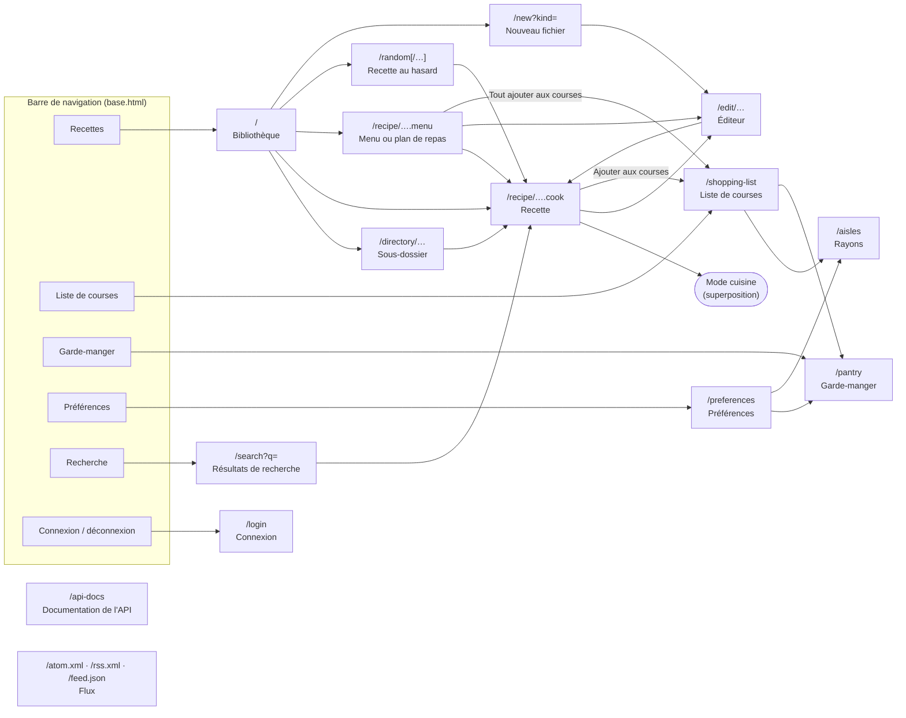

# Cartographie des pages du site web (`cook server`)

Ce document décrit chaque page de l'interface web : son adresse, son rôle, ce
qu'elle affiche, les actions possibles, les droits nécessaires, les appels API
qu'elle fait et le code qui la produit.

Voir aussi : [cartographie des fonctionnalités](cartographie-fonctionnalites.md)
· [pile technique du serveur](stack-technique-serveur.md)
· [authentification et autorisations](authentification-serveur.md)
· [référence de l'API](api.md).

Toutes les adresses sont relatives à la racine du serveur (par défaut
`http://localhost:9080`). Avec `--url-prefix /cook`, elles commencent toutes
par `/cook`. Les routes des pages sont déclarées dans `src/server/ui.rs`
(fonction `ui()`), celles de l'API dans `src/server/mod.rs` (fonction `api()`).

## Plan du site

## Vue d'ensemble

| Page | Route | Template | Droits pour lire | Droits pour modifier |
|---|---|---|---|---|
| [Bibliothèque](#1-bibliothèque) | `GET /`, `GET /directory/{*path}` | `recipes.html` | tous | — |
| [Recette au hasard](#2-recette-au-hasard) | `GET /random`, `GET /random/{*path}` | — (redirection) | tous | — |
| [Recette](#3-recette) | `GET /recipe/{*path}.cook` | `recipe.html` | tous | `shopper` (courses), `editor` (photos d'étape) |
| [Menu / plan de repas](#4-menu-et-plan-de-repas) | `GET /recipe/{*path}.menu` | `menu.html` | tous | `shopper` (courses), `editor` (calendrier) |
| [Recherche](#5-recherche) | `GET /search?q=` | `search.html` | tous | — |
| [Éditeur](#6-éditeur) | `GET /edit/{*path}` | `edit.html` | `editor` | `editor` |
| [Nouveau fichier](#7-nouveau-fichier) | `GET /new`, `POST /new` | `new.html` | `editor` | `editor` |
| [Liste de courses](#8-liste-de-courses) | `GET /shopping-list` | `shopping_list.html` | tous¹ | `shopper` |
| [Garde-manger](#9-garde-manger) | `GET /pantry` | `pantry.html` | tous¹ | `shopper` |
| [Rayons](#10-rayons) | `GET /aisles` | `aisles.html` | tous¹ | `shopper` |
| [Préférences](#11-préférences) | `GET /preferences` | `preferences.html` | tous | `admin` (sync cook.md) |
| [Documentation de l'API](#12-documentation-de-lapi) | `GET /api-docs` | `api_docs.html` | tous¹ | — |
| [Connexion](#13-connexion-et-déconnexion) | `GET/POST /login`, `POST /logout` | `login.html` | tous | — |
| [Flux](#14-flux-de-syndication) | `GET /atom.xml`, `/rss.xml`, `/feed.json` | — (XML / JSON) | tous | — |
| [Page d'erreur](#15-page-derreur) | toute route en échec | `error.html` | — | — |

« Droits » suppose qu'un fichier `users.toml` existe. Sans lui, tout le monde
peut tout faire. ¹ Avec `--recipes-only`, un visiteur non connecté n'a accès
qu'à la bibliothèque, aux recettes, à la recherche, aux préférences (réduites
au choix de la langue) et aux flux ; les autres pages lui demandent de se
connecter.

---

## Éléments communs à toutes les pages (`base.html`)

Toutes les pages héritent de `templates/base.html`.

- **Barre de navigation** : Recettes, Liste de courses, Garde-manger,
  Préférences. Les entrées affichées dépendent des fonctionnalités activées
  dans les préférences (`features_middleware`) et du rôle de l'utilisateur.
  Sur petit écran, un menu « plus d'options » les regroupe.
- **Recherche instantanée** dans l'en-tête : la saisie interroge
  `GET /api/search` et affiche une liste déroulante, avec un lien « voir tous
  les résultats » vers `/search?q=` (`static/js/search.js`).
- **Thème clair / sombre** : bouton dans l'en-tête, ou touche `t`.
- **Connexion** : quand la connexion est active, l'en-tête affiche « Connecté
  en tant que … » et un bouton de déconnexion, ou un lien de connexion.
- **Raccourcis clavier** (`static/js/keyboard-shortcuts.js`, aide avec `?`) :

  | Touche | Effet |
  |---|---|
  | `/` | Aller au champ de recherche |
  | `g h` / `g s` / `g p` / `g x` | Recettes / courses / garde-manger / préférences |
  | `t` | Basculer le thème |
  | `Échap` | Fermer une fenêtre ou une liste |

- **Modifications non enregistrées** (`static/js/unsaved.js`) : quitter une
  page qui contient des données saisies et non envoyées demande confirmation.
- **Refus d'écriture** (`static/js/sign-in-notice.js`) : quand une action est
  refusée (401 ou 403), un bandeau l'explique, avec un lien de connexion pour
  un visiteur non connecté.
- **Langue** : choisie d'après l'en-tête `Accept-Language` du navigateur parmi
  10 langues (`locales/`), ou fixée dans les préférences.

---

## 1. Bibliothèque

| | |
|---|---|
| **Routes** | `GET /` (racine), `GET /directory/{*path}` (sous-dossier) |
| **Handler** | `recipes_page`, `recipes_directory` → `recipes_handler` (`src/server/ui.rs`) |
| **Template** | `templates/recipes.html`, cartes `templates/recipe_card.html` |

**Rôle** : parcourir la collection de recettes dossier par dossier.

**Contenu**
- Fil d'Ariane du dossier courant.
- Cartes des sous-dossiers, des recettes (`.cook`) et des menus (`.menu`),
  avec image de titre quand elle existe, et le nombre de recettes.
- Bannière **« Menu du jour »** quand un plan de repas contient la date du
  jour, avec un lien vers ce plan.
- Message dédié quand le dossier est vide.

**Actions**
- Trier par nom, date de création ou date de modification, et inverser
  l'ordre.
- **Recette au hasard** dans le dossier courant (→ `/random/…`).
- **Nouvelle recette**, **nouveau menu**, **nouveau plan** (→ `/new`) : boutons
  visibles seulement pour un `editor`.

## 2. Recette au hasard

| | |
|---|---|
| **Routes** | `GET /random` (toute la collection), `GET /random/{*path}` (un dossier) |
| **Handler** | `random_recipe_page`, `random_recipe_directory` |

**Rôle** : choisir une recette au hasard et rediriger vers sa page
`/recipe/…`. Pas de template propre.

## 3. Recette

| | |
|---|---|
| **Route** | `GET /recipe/{*path}` (chemin d'un fichier `.cook`) |
| **Paramètres** | `?scale=2` (facteur) ou `?servings=6` (nombre de portions) |
| **Handler** | `recipe_page` → `web::builders::build_recipe_template` |
| **Template** | `templates/recipe.html` |
| **Scripts** | `static/js/cooking-mode.js`, `static/js/timers.js` |
| **API appelée** | `POST /api/shopping_list/add` |

**Rôle** : afficher une recette, la mettre à l'échelle et cuisiner.

**Contenu**
- Titre, image, description, métadonnées (temps de préparation et de cuisson,
  tags, source…).
- **Ingrédients** (avec les optionnels marqués), **ustensiles**.
- **Étapes** numérotées, regroupées par section, avec les ingrédients, les
  ustensiles et les minuteurs mis en évidence ; photo d'étape le cas échéant.
- Les références à d'autres recettes sont des liens vers leur page.
- Indication « écrite pour N portions » quand la recette est mise à
  l'échelle, avec un rappel que les temps de cuisson peuvent varier.

**Actions**

| Action | Comment | Droits |
|---|---|---|
| Mettre à l'échelle | Boutons +/− sur le facteur ou sur les portions, ou paramètre d'URL | tous |
| **Mode cuisine** | Bouton « Commencer à cuisiner » : affichage plein écran, étape par étape, avec les minuteurs | tous |
| Lancer un minuteur | Clic sur un minuteur d'une étape | tous |
| Ajouter à la liste de courses | Bouton, à l'échelle courante | `shopper` |
| Modifier | Bouton → `/edit/…` | `editor` |
| Ajouter ou changer la photo d'une étape | Icône sur l'étape → `/edit/…#picture=<section>.<étape>` | `editor` |
| Imprimer | Raccourci `p` | tous |

**Raccourcis propres à la page** : `c` mode cuisine, `e` modifier, `a` ajouter
aux courses, `p` imprimer, `+` / `-` échelle, `[` / `]` échelle par pas de 0,5.

## 4. Menu et plan de repas

| | |
|---|---|
| **Route** | `GET /recipe/{*path}` (chemin d'un fichier `.menu`) |
| **Paramètres** | `?scale=` ou `?servings=` |
| **Handler** | `recipe_page` (même handler que la recette, sortie `Menu`) ; `handlers::plans::annotate` pour l'édition |
| **Template** | `templates/menu.html` |
| **Script** | `static/js/src/planner.js` (dans `editor.bundle.js`) |
| **API appelées** | `POST /api/shopping_list/add_menu`, `POST /api/plans/{path}` |

**Rôle** : afficher un menu (liste de recettes) ou un plan de repas
(calendrier par jour et par repas).

**Contenu**
- Type du fichier : menu ou plan.
- Pour un plan : un calendrier par jour, avec les repas (petit-déjeuner,
  déjeuner, dîner, en-cas) et les recettes de chacun ; les lignes hors des
  jours du plan sont regroupées à part.
- Liens vers chaque recette référencée.

**Actions**

| Action | Comment | Droits |
|---|---|---|
| Mettre à l'échelle | +/− sur le facteur ou les portions | tous |
| Tout ajouter à la liste de courses | Bouton ; pour un plan, choix des jours (tous, aucun, une semaine) | `shopper` |
| Ajouter une recette à un repas | Sélecteur de recette (`recipe_picker.html`) | `editor` |
| Retirer, déplacer, copier une ligne | Menu de la ligne ou glisser-déposer | `editor` |
| Ajouter des jours au plan | Bouton | `editor` |
| Modifier le texte | Bouton → `/edit/…` | `editor` |

Chaque modification du calendrier envoie `POST /api/plans/{path}`. Le serveur
modifie le texte du `.menu` et **refuse une modification faite sur une version
plus ancienne** que celle du disque ; la page se recharge alors pour montrer
l'état réel.

## 5. Recherche

| | |
|---|---|
| **Route** | `GET /search?q=<texte>` |
| **Handler** | `search_page` |
| **Template** | `templates/search.html` |

**Rôle** : afficher tous les résultats d'une recherche sous forme de cartes.
On y arrive en appuyant sur Entrée dans le champ de recherche de l'en-tête.

**Contenu** : le nombre de résultats et une carte par recette trouvée, ou un
message « aucun résultat ». La recherche porte sur les titres, ingrédients,
étapes et métadonnées.

## 6. Éditeur

| | |
|---|---|
| **Route** | `GET /edit/{*path}` (recette `.cook` ou menu `.menu`) |
| **Handler** | `edit_page` |
| **Template** | `templates/edit.html` |
| **Script** | `static/js/editor.bundle.js` (sources : `editor.js`, `toolbar.js`, `cooklang-mode.js`, `picker.js`) |
| **API appelées** | `GET/PUT/DELETE /api/recipes/{path}`, `POST /api/recipe_rename/{path}`, `GET/PUT/DELETE /api/recipe_image/{path}`, WebSocket `GET /api/ws/lsp` |
| **Droits** | `editor` pour ouvrir la page comme pour enregistrer |

**Rôle** : modifier le texte Cooklang d'une recette ou d'un menu.

**Contenu**
- Éditeur **CodeMirror 6** avec la coloration syntaxique Cooklang.
- **Diagnostics en direct et autocomplétion** (ingrédients, ustensiles,
  minuteurs) fournis par le serveur de langage `cook lsp`, via WebSocket.
- **Barre d'outils d'insertion** : ingrédient, ustensile, minuteur, section,
  métadonnées, note, commentaire (ligne ou bloc), référence à une recette ;
  pour un menu ou un plan : jour (avec date), repas, ajout de recette.
- Indicateur d'état : enregistrement en cours, enregistré, échec.

**Actions**

| Action | API |
|---|---|
| Enregistrer | `PUT /api/recipes/{path}` |
| Renommer ou déplacer le fichier | `POST /api/recipe_rename/{path}` |
| Ajouter, changer ou retirer une image | `PUT` / `DELETE /api/recipe_image/{path}` (photos jusqu'à une taille supérieure à la limite générale de 1 Mo) |
| Supprimer la recette (avec confirmation) | `DELETE /api/recipes/{path}` |
| Revenir à la recette | lien vers `/recipe/…` |

La page prévient si le fichier a disparu du disque pendant l'édition, et
demande confirmation avant de quitter avec des modifications non enregistrées.
Le nombre de connexions au serveur de langage est limité par
`--max-lsp-sessions` ; au-delà, l'éditeur fonctionne sans autocomplétion et se
reconnecte quand une place se libère.

## 7. Nouveau fichier

| | |
|---|---|
| **Routes** | `GET /new` (formulaire), `POST /new` (création) |
| **Paramètres** | `?kind=recipe\|menu\|plan`, `?filename=`, `?error=` (retour après échec) |
| **Handlers** | `new_page`, `create_recipe` |
| **Template** | `templates/new.html` |
| **Droits** | `editor` |

**Rôle** : créer une recette, un menu ou un plan de repas.

**Formulaire**
- **Recette** ou **menu** : chemin et nom du fichier (des sous-dossiers sont
  possibles).
- **Plan de repas** : nom, date de début (aujourd'hui, cette semaine, la
  semaine prochaine), durée (une ou deux semaines, ou un nombre de jours),
  repas à prévoir, nombre de portions.

Après la création, le navigateur est redirigé vers l'éditeur du nouveau
fichier. En cas d'erreur (nom invalide, fichier existant…), il revient au
formulaire avec le message. Le serveur vérifie que le formulaire vient bien de
sa propre origine.

## 8. Liste de courses

| | |
|---|---|
| **Route** | `GET /shopping-list` |
| **Handler** | `shopping_list_page` |
| **Template** | `templates/shopping_list.html` |
| **API appelées** | `GET /api/shopping_list/items`, `POST /api/shopping_list`, `GET /api/shopping_list/checked`, `POST /api/shopping_list/check` / `uncheck`, `POST /api/shopping_list/remove`, `POST /api/shopping_list/clear`, `GET /api/shopping_list/extra_items`, `POST /api/shopping_list/remove_extra_item`, `GET /api/aisles`, `POST /api/aisles/changes`, SSE `GET /api/shopping_list/events` |
| **Données** | `.shopping-list` et `.shopping-checked` à la racine du dossier de recettes |

**Rôle** : la liste de courses persistante, partagée par tous ceux qui
utilisent le serveur.

**Contenu**
- **Recettes sélectionnées**, avec leur échelle.
- **Ingrédients agrégés** (les mêmes ingrédients sont additionnés), groupés
  par rayon selon `aisle.conf`.
- Ingrédients déjà **présents dans le garde-manger**, mis à part.
- **Articles libres** : lignes du fichier `.shopping-list` qui ne viennent pas
  d'une recette (ajoutées en éditant le fichier, par exemple).
- Avertissements (par exemple : garde-manger illisible, donc rien n'a été
  retiré de la liste).

**Actions**

| Action | Droits |
|---|---|
| Cocher / décocher un article | `shopper` |
| Retirer une recette de la liste | `shopper` |
| Retirer un article libre | `shopper` |
| Ranger un ingrédient dans un rayon, ou créer un rayon | `shopper` |
| Vider la liste | `shopper` |
| Copier la liste dans le presse-papiers, avec ou sans quantités et rayons | tous |
| Ouvrir le garde-manger ou la gestion des rayons | — |

**Temps réel** : la page reste abonnée à `GET /api/shopping_list/events`
(Server-Sent Events). Quand quelqu'un d'autre modifie la liste, depuis un
autre appareil ou en éditant les fichiers à la main, la page se met à jour
seule (`server/shopping_list_watcher.rs`).

## 9. Garde-manger

| | |
|---|---|
| **Route** | `GET /pantry` |
| **Handler** | `pantry_page` |
| **Template** | `templates/pantry.html` |
| **API appelées** | `GET /api/pantry`, `POST /api/pantry/add`, `PUT/DELETE /api/pantry/{section}/{name}`, `POST /api/pantry/rename`, `GET/PUT /api/pantry/raw` |
| **Données** | `pantry.conf` (TOML), dans `./config/` ou le dossier de config global |

**Rôle** : tenir l'inventaire de ce qu'on a déjà, pour le retirer de la liste
de courses.

**Contenu**
- **Onglet Articles** : les articles regroupés par section (garde-manger,
  frigo, congélateur, épices…), avec la quantité, la date d'achat, la date de
  péremption et l'état du stock (point de couleur).
- Étiquettes de péremption : périmé, périme aujourd'hui, périme dans N jours.
- **Filtres** : tous, bientôt périmés, stock bas, épuisés, vides.
- **Onglet Texte** : le fichier `pantry.conf` brut, modifiable.
- Si aucun fichier n'existe : un bouton pour le créer.

**Actions** (`shopper`)
- Ajouter, modifier, supprimer un article : nom, quantité, seuil de stock bas,
  date d'achat, date de péremption.
- Renommer une section.
- Enregistrer le texte brut. Le serveur détecte un conflit si le fichier a
  changé entre-temps. Les commentaires du fichier sont conservés à chaque
  modification.

## 10. Rayons

| | |
|---|---|
| **Route** | `GET /aisles` |
| **Handler** | `aisles_page` |
| **Template** | `templates/aisles.html` |
| **API appelées** | `GET/POST /api/aisles` (lecture, création du fichier), `POST /api/aisles/changes`, `GET/PUT /api/aisles/raw`, `GET /api/aisles/uncategorized` |
| **Données** | `aisle.conf`, dans `./config/` ou le dossier de config global |

**Rôle** : décrire les rayons du magasin, pour trier la liste de courses.

**Contenu**
- **Onglet Rayons** : chaque rayon et ses ingrédients, avec un filtre.
- **Onglet Non classés** : les ingrédients des recettes qui ne sont dans aucun
  rayon, avec les recettes qui les utilisent.
- **Onglet Texte** : le fichier `aisle.conf` brut, modifiable.
- Avertissement pour les lignes qui ressemblent à des commentaires mais n'en
  sont pas (`#`, `--` : seul `//` est un commentaire dans ce fichier).

**Actions** (`shopper`)
- Créer, renommer, supprimer, réordonner un rayon.
- Ajouter, retirer, déplacer un ingrédient ; sélection multiple pour déplacer
  plusieurs ingrédients d'un coup.
- **Regrouper des synonymes** sous un nom principal, que la liste de courses
  affichera.
- Classer les ingrédients non classés.
- Enregistrer le texte brut, avec détection de conflit.

## 11. Préférences

| | |
|---|---|
| **Route** | `GET /preferences` |
| **Handler** | `preferences_page` |
| **Template** | `templates/preferences.html` |
| **API appelées** | `GET /api/sync/status`, `POST /api/sync/login`, `POST /api/sync/cancel_login`, `POST /api/sync/logout` |

**Rôle** : réglages de l'interface et informations sur le serveur.

**Contenu**
- **Langue** de l'interface.
- **Fonctionnalités** affichées dans la barre de navigation (liste de
  courses, garde-manger…).
- Chemins utilisés : dossier de recettes, `aisle.conf`, `pantry.conf`.
- Liens vers la gestion du garde-manger et des rayons.
- Version de CookCLI.
- **Synchronisation cook.md** (si compilée avec la feature `sync`) : état,
  compte connecté, connexion par code d'appareil, déconnexion. Réservé au
  rôle `admin`.

Avec `--recipes-only`, un visiteur non connecté ne voit que le choix de la
langue.

## 12. Documentation de l'API

| | |
|---|---|
| **Route** | `GET /api-docs` |
| **Handler** | `api_docs_page` |
| **Template** | `templates/api_docs.html` |
| **Source** | `src/web/api_docs.rs` (également exportée dans [`docs/api.md`](api.md)) |

**Rôle** : documentation interactive de tous les points d'accès `/api`,
générée à partir du code. Un test vérifie que chaque route enregistrée est
documentée.

## 13. Connexion et déconnexion

| | |
|---|---|
| **Routes** | `GET /login` (formulaire), `POST /login`, `POST /logout` |
| **Handlers** | `auth::handlers::login_page`, `login`, `logout` |
| **Template** | `templates/login.html` |
| **Paramètre** | `?next=` : page où revenir après la connexion |

Ces pages n'existent que lorsqu'un fichier `users.toml` est présent. Le
formulaire demande le nom et le mot de passe ; en cas de succès, un cookie de
session est posé et le navigateur revient à la page `next`. La déconnexion
révoque la session côté serveur. Détails :
[authentification et autorisations](authentification-serveur.md).

## 14. Flux de syndication

| Route | Format |
|---|---|
| `GET /atom.xml` | Atom |
| `GET /rss.xml` | RSS 2.0 |
| `GET /feed.json` | JSON Feed |

**Handlers** : `atom_feed`, `rss_feed`, `json_feed` → `feed_response`.
Les flux listent les recettes avec des liens absolus, calculés à partir de
l'adresse de la requête et de `--url-prefix`. Les mêmes flux sont produits par
`cook build web` pour le site statique.

## 15. Page d'erreur

| | |
|---|---|
| **Template** | `templates/error.html` |
| **Fonction** | `ui::error_page` |

Affichée quand une page ne peut pas être construite : recette introuvable,
chemin invalide (seuls les fichiers `.cook` et `.menu` sont acceptés), erreur
de lecture. Le message passe par `private_paths::hide`, qui remplace les
chemins absolus par des chemins relatifs au dossier de recettes.

---

## Composants partagés

| Composant | Fichier | Utilisé par |
|---|---|---|
| Carte de recette | `templates/recipe_card.html` | Bibliothèque, recherche |
| Sélecteur de recette (fenêtre de recherche) | `templates/recipe_picker.html`, `static/js/src/picker.js` | Éditeur (référence de recette), plan de repas (ajout) |
| Mode cuisine | `static/js/cooking-mode.js`, `static/css/cooking-mode.css` | Recette |
| Minuteurs | `static/js/timers.js` | Recette, mode cuisine |
| Barre d'outils de l'éditeur | `static/js/src/toolbar.js` | Éditeur |
| Planificateur | `static/js/src/planner.js` | Plan de repas |

## Ressources servies hors pages

| Route | Contenu |
|---|---|
| `GET /static/{*file}` | CSS, JS et icônes de l'application, intégrés au binaire (`rust-embed`) |
| `GET /api/static/{*file}` | Images du dossier de recettes uniquement ; jamais un fichier dont le nom commence par `.` (`server/static_files.rs`) |
