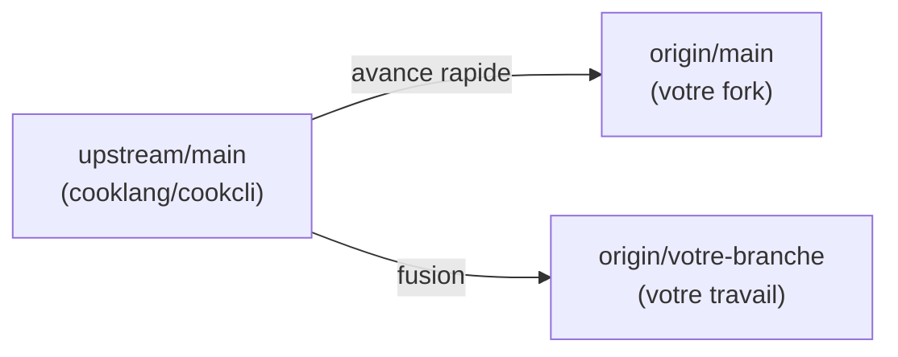

# Synchroniser le fork avec le projet d'origine

Ce dépôt (`DarkPsionix/cookcli`) est un fork de
[`cooklang/cookcli`](https://github.com/cooklang/cookcli). Le projet d'origine
avance régulièrement : nouvelles fonctionnalités, corrections de sécurité,
mises à jour de dépendances. Cette procédure récupère ses nouveaux commits
sans perdre votre propre travail.

## Principe



- **`main` reste une copie exacte du projet d'origine.** Vous n'y commitez
  rien directement : il se met à jour en **avance rapide** (fast-forward),
  sans commit de fusion ni conflit possible.
- **Votre travail vit sur des branches** (par exemple la branche de
  documentation), dans lesquelles vous **fusionnez** `main` ou `upstream/main`.

## Configuration (une seule fois)

```bash
git remote add upstream https://github.com/cooklang/cookcli
git remote -v
```

Vous devez voir deux remotes : `origin` (votre fork) et `upstream` (le projet
d'origine).

## 1. Voir ce qui a changé

```bash
git fetch upstream
git fetch origin
```

```bash
git log --oneline origin/main..upstream/main
```

Cette commande liste les commits du projet d'origine absents de votre `main`.
Rien ne s'affiche : vous êtes à jour.

Pour voir les fichiers touchés :

```bash
git diff --stat origin/main upstream/main
```

Vérifiez que votre `main` n'a pas de commit propre (rien ne doit s'afficher) :

```bash
git log --oneline upstream/main..origin/main
```

## 2. Mettre à jour `main`

```bash
git checkout main
git merge --ff-only upstream/main
git push origin main
```

`--ff-only` refuse d'agir si une fusion serait nécessaire : c'est une sécurité.
Si la commande échoue, votre `main` contient des commits propres (voir
[Cas particuliers](#cas-particuliers)).

## 3. Mettre à jour une branche de travail

```bash
git checkout ma-branche
git merge main
git push origin ma-branche
```

- Sans conflit, la fusion se fait toute seule.
- S'il y a des conflits, voir la section suivante.

Une alternative est le **rebase** (`git rebase main`), qui donne un historique
linéaire. Ne l'utilisez que sur une branche que **personne d'autre** n'utilise,
car il réécrit l'historique et oblige à pousser avec `--force-with-lease`.

## 4. Résoudre un conflit

```bash
git status                  # liste les fichiers en conflit
```

Dans chaque fichier, git a inséré les deux versions :

```text
<<<<<<< HEAD
votre version
=======
la version du projet d'origine
>>>>>>> main
```

Gardez le bon contenu, supprimez les marqueurs, puis :

```bash
git add fichier-corrige
git commit                  # termine la fusion
```

Pour abandonner et revenir à l'état d'avant :

```bash
git merge --abort
```

### Fichiers à surveiller

| Fichier | Conseil |
|---|---|
| `Cargo.lock`, `package-lock.json` | Ne les fusionnez pas à la main : prenez la version d'origine (`git checkout --theirs Cargo.lock`), puis régénérez (`cargo update -w` ou `npm install`) |
| `locales/*/*.ftl` | Après la fusion, **vérifiez qu'aucune clé n'est définie deux fois** : `cargo test --test locales_test`. Une clé en double fait planter toutes les pages de cette langue |
| `docs/api.md` | Fichier généré : régénérez-le avec `UPDATE_API_DOCS=1 cargo test --test api_docs_md_test` |
| `CHANGELOG.md` | Prenez la version d'origine ; il est produit automatiquement à chaque version |
| `tests/snapshots/*.snap` | Relancez les tests puis `cargo insta review` |

## 5. Vérifier après la mise à jour

```bash
npm ci
npm run build-css
npm run build-js
cargo build
cargo test --no-fail-fast
```

Les mises à jour du projet d'origine sont testées par sa CI, mais votre fusion
peut combiner deux changements incompatibles : ne sautez pas cette étape si
votre branche contient du code.

Lisez aussi le [CHANGELOG](../CHANGELOG.md) pour repérer ce qui peut vous
concerner : nouvelles options, changements de comportement, sécurité.

## Cas particuliers

**Votre `main` contient des commits propres** (`git merge --ff-only` échoue) :
déplacez-les sur une branche, puis réalignez `main`.

```bash
git checkout main
git branch sauvegarde-main
git reset --hard upstream/main
git push --force-with-lease origin main
```

Vos commits restent dans `sauvegarde-main`, d'où vous pouvez les fusionner
ailleurs. `reset --hard` et `push --force` réécrivent `main` : vérifiez deux
fois avant de les lancer.

**Le push vers GitHub est refusé (403)** : l'outil qui pousse n'a pas le droit
d'écrire sur le dépôt. Pour Claude, installez l'application Claude GitHub sur
le dépôt, ou reconnectez GitHub dans les réglages de claude.ai.

**Les workflows GitHub (`.github/workflows/`) changent** : un push qui modifie
ces fichiers peut demander une autorisation spéciale (`workflow`) au jeton
utilisé.

## Alternative : depuis l'interface GitHub

Sur la page du fork, le bouton **Sync fork** met `main` à jour depuis le
projet d'origine, quand aucune fusion n'est nécessaire. Il faut ensuite faire
`git fetch origin` en local, puis fusionner `main` dans vos branches comme au
§ 3.

## Fréquence conseillée

- **Chaque semaine ou deux** : les mises à jour de dépendances arrivent par
  petits lots (Dependabot) et se fusionnent sans effort.
- **Immédiatement** pour un correctif de sécurité annoncé dans une version.
- **Avant de commencer** une nouvelle branche de travail, pour partir d'une
  base à jour.
